  

  

  A cheesehead from the Netherlands 🇳🇱 who writes backends for a living
  (Python, Go, Java, C#) and, after hours, takes apart old games and cheap hardware.

---

## 🎮 `PLAYER 1` · Retro ports

DOS-era games running on a Game Boy Advance, built from open source engines and reconstructions.
You supply the original game data.

<table>
  <tr>
    <td align="center" width="33%">
      
       <b><a href="https://github.com/Berobloom/cosmore-advance">cosmore-advance</a></b>
       Cosmo's Cosmic Adventure on the GBA and Linux (SDL2)
    </td>
    <td align="center" width="33%">
      
       <b><a href="https://github.com/Berobloom/openjazz-advance">openjazz-advance</a></b>
       Jazz Jackrabbit on the GBA, from OpenJazz
    </td>
    <td align="center" width="33%">
      
       <b><a href="https://github.com/Berobloom/deathrally-advance">deathrally-advance</a></b>
       Death Rally on the GBA, from dRally
    </td>
  </tr>
</table>

## 🏁 `PLAYER 2` · Reverse engineering

**[a2racer2-re](https://github.com/Berobloom/a2racer2-re)**: a study of the 1998 Dutch
racer **A2 Racer II**, worked out from its binaries, plus a new engine in C (SDL2, OpenGL)
that plays the whole game on Linux and in the browser through WebAssembly.
It reads the original data files unchanged.

`C` · `SDL2` · `OpenGL` · `Emscripten`

 

## 📷 `PLAYER 3` · Decloud the cheap stuff

Budget smart-home gear from LSC (Action), running fully local with no Tuya cloud and no phone app.

| Project | What it does |
| --- | --- |
| **[LSC-1080p-Anyka-Decloud](https://github.com/Berobloom/LSC-1080p-Anyka-Decloud)** | Local RTSP and ONVIF for the 2025 LSC 1080p indoor cam (Anyka AK3918AV130). Ready for Home Assistant and Frigate. |
| **[LSCIndoorCameraLocal1080p](https://github.com/Berobloom/LSCIndoorCameraLocal1080p)** | Local streaming for the 2021 Fullhan version of the same camera. |
| **[lscdoorbellmqtt](https://github.com/Berobloom/lscdoorbellmqtt)** | A Go MQTT client for the LSC video doorbell on OpenIPC, so the bell shows up in Home Assistant. |

---

  ▶ INSERT COIN TO CONTINUE ◀

